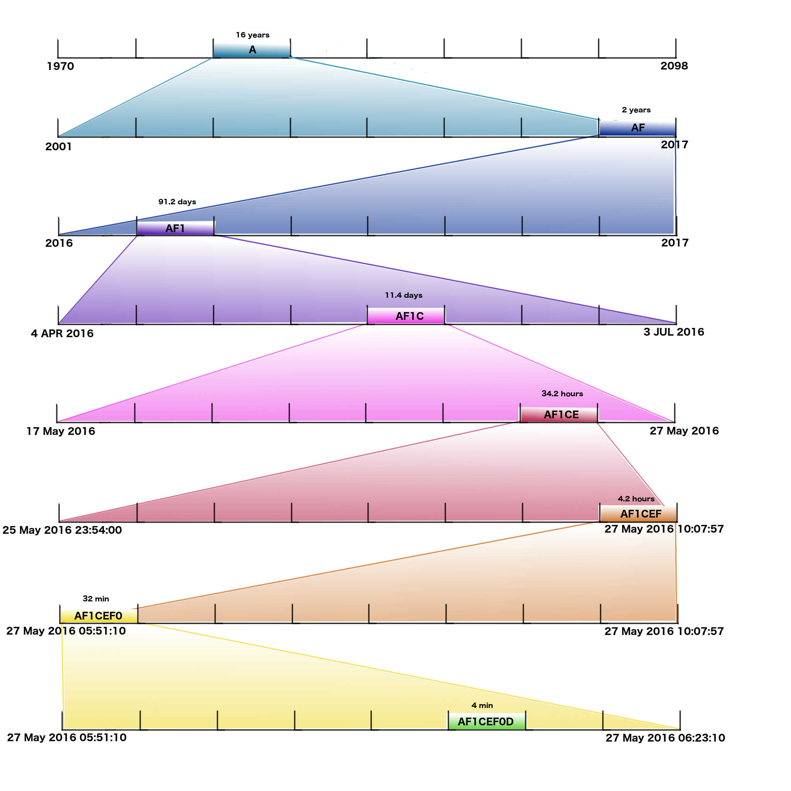

# timehash

[](LICENSE)

`timehash` is an algorithm with multi-language reference implementations for calculating variable-precision, sliding-window temporal hashes. When performing correlations and aggregations on large-scale datasets, converting exact millisecond timestamps into malleable, hierarchical intervals creates a powerful primitive for spatiotemporal analytics.



---

## Features

- **Hierarchical Representation**: Encodes Unix timestamps into variable-length ASCII character hashes (`01abcdef`).
- **Sliding Temporal Windows**: Calculate neighboring time windows (`before`, `after`, `neighbors`, `expand`) to eliminate expensive range scans and boundary edge effects.
- **Spatiotemporal Compound Keys**: Combining `geohash` and `timehash` (e.g. `geohash_timehash`) forms an ideal compound key for distributed key-value stores (DuckDB, ClickHouse, Redis, HBase, Bigtable, DynamoDB).
- **Multi-Language Support**: Reference implementations provided in Python, Go, Java, C, C#, and Perl.

---

## Precision & Window Sizes

Each character added to a `timehash` reduces the temporal window size by a factor of 8 (octal decomposition over a 128-year epoch from 1970 to 2098):

| Precision | Approximate Window Size (± Window) | Example Code |
|:---------:|:----------------------------------:|:------------|
| 1 | ± 16 years | `a` |
| 2 | ± 2 years (~730 days) | `ae` |
| 3 | ± 91.25 days (~3 months) | `ae0` |
| 4 | ± 11.4 days | `ae0f` |
| 5 | ± 1.42 days (~34 hours) | `ae0f0` |
| 6 | ± 4.28 hours | `ae0f0b` |
| 7 | ± 32.1 minutes | `ae0f0ba` |
| 8 | ± 4.01 minutes (~240.8 s) | `ae0f0ba1` |
| 9 | ± 30 seconds | `ae0f0ba1f` |
| 10 | ± 3.76 seconds | `ae0f0ba1fc` |

---

## Quickstart

### Python

#### Installation
```bash
pip install .
```

#### Usage
```python
import time
import timehash

now = time.time()

# Encode current time to precision 10 (~3.76s window)
code = timehash.encode(now, precision=10)
print(f"Timehash: {code}")

# Decode window range (start_timestamp, end_timestamp)
window_start, window_end = timehash.decode(code)
print(f"Window: {window_start} -> {window_end}")

# Sliding window operations
prev_window = timehash.before(code)
next_window = timehash.after(code)
expanded = timehash.expand(code)  # [before, current, after]
print(f"Expanded 3-window block: {expanded}")
```

### Running Tests
```bash
pytest test_sample.py
```

---

## Implementations in Other Languages

- **Go**: [`timehash.go`](timehash.go)
- **Java**: [`TimeHash.java`](TimeHash.java)
- **C**: [`time_hash.h`](time_hash.h) & [`c-impl/`](c-impl/)
- **C#**: [`TimeHash.cs`](TimeHash.cs)
- **Perl**: [`timehash.pl`](timehash.pl)
- **JavaScript (Community)**: [disarticulate/time-hash](https://github.com/disarticulate/time-hash)
- **Rust (Community)**: [dwyerk/timeharsh](https://github.com/dwyerk/timeharsh)

---

## Repository Structure

```
timehash/
├── AGENTS.md                 # Technical reference for AI agents
├── README.md                 # Project documentation (this file)
├── README.rst                # Original documentation
├── CHANGES.md                # Changelog
├── CONTRIBUTORS.md           # Authors and contributors
├── LICENSE                   # BSD 3-Clause License
├── setup.py / setup.cfg      # Packaging
├── test_sample.py            # Python tests
│
├── timehash/                 # Python implementation
│   └── __init__.py
├── timehash.go               # Go implementation
├── TimeHash.java             # Java implementation
├── TimeHash.cs               # C# implementation
├── time_hash.h / c-impl/     # C implementation
└── timehash.pl               # Perl implementation
```

---

## AI Agent Guidance

For full algorithm specifications, bit-level invariants, and architectural guidelines, see [AGENTS.md](AGENTS.md).

---

## License

This project is licensed under the **Modified BSD (3-Clause) License**. See [LICENSE](LICENSE) for details.

## Contributors & Credits

- **TimeHash Guru**: [Abe Usher](http://www.linkedin.com/in/socialnetworkanalysis)
- **Python Packager**: [Kevin Dwyer (@pheared)](https://github.com/dwyerk)
- **Golang**: Justin Shelton (@kwonstant)
- **C & C#**: Sam Mason
- **JavaScript**: Eric Xanderson
